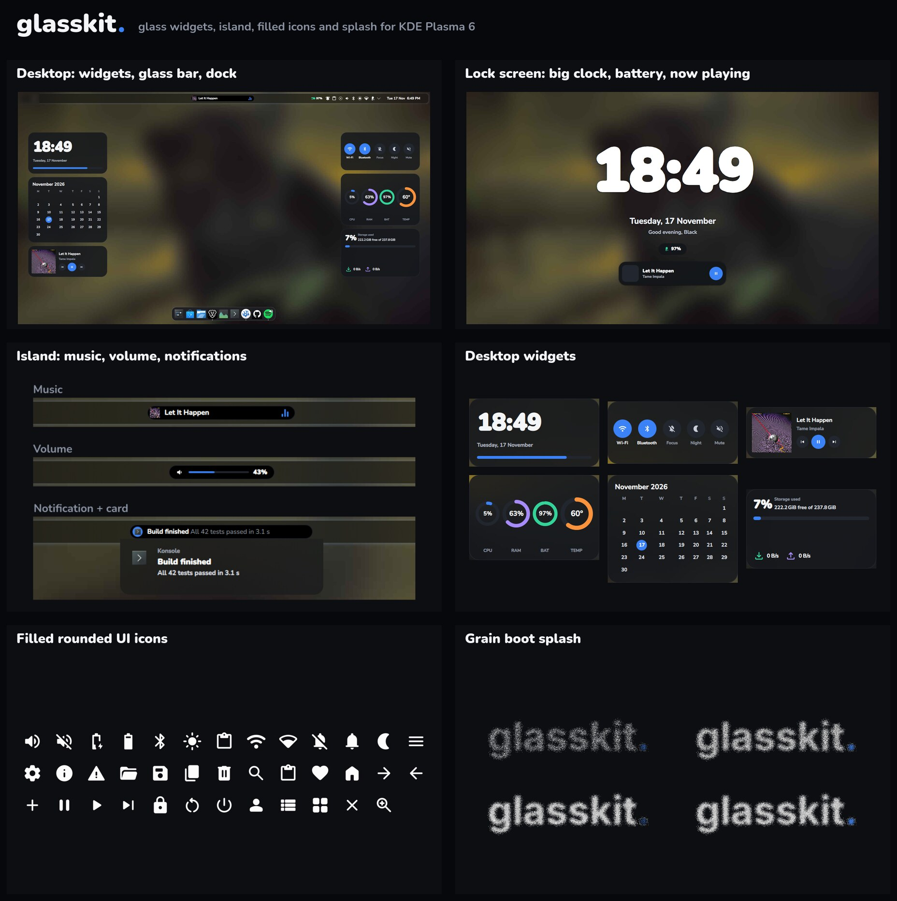
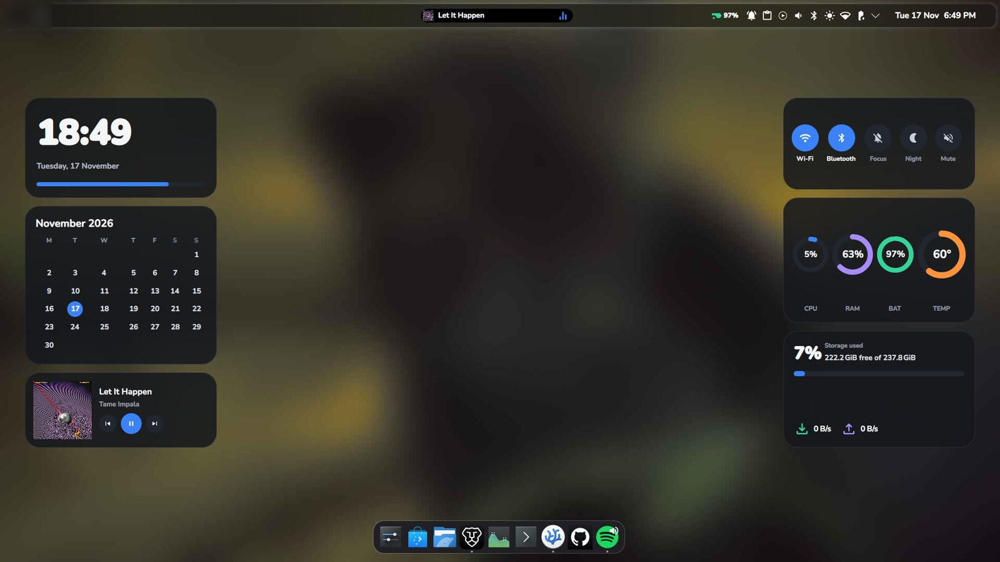
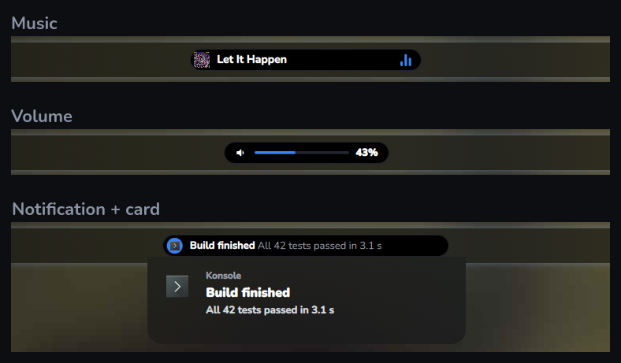
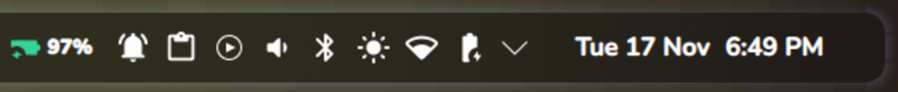
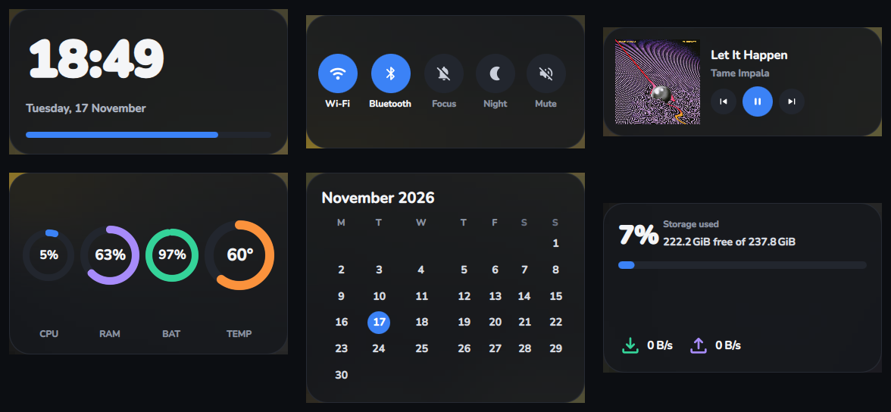
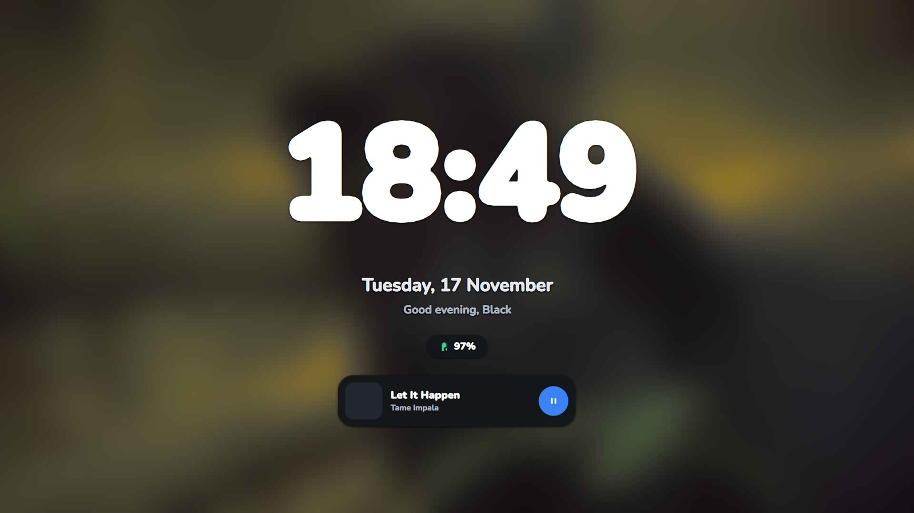
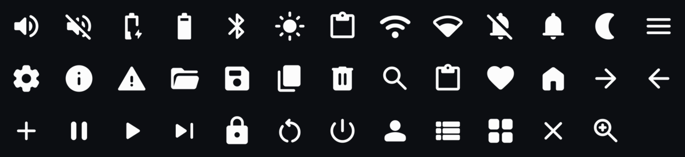
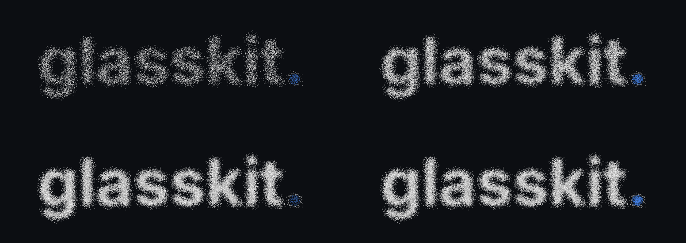

# glasskit

Frosted-glass widgets, a dynamic top-bar island, filled rounded icons and a grain boot splash for **KDE Plasma 6**. Everything installs per user, with no root.



## What you get

| Piece | What it does |
|---|---|
| **Island** (top bar) | A black pill that springs open for music (art, title, equaliser), notifications, volume changes, charging and low battery. It also shows an orange dot while an app records from the microphone. Click it for a media card with a progress bar. |
| **Battery Pill** (top bar) | Battery icon and percentage. Turns green while charging and orange at 15% or below. |
| **Desktop widgets** | Clock with day progress, month calendar, CPU/RAM/battery/temperature rings, media player, quick toggles (Wi-Fi, Bluetooth, Do Not Disturb, Night Light, Mute), storage and network speed, Pomodoro focus timer. |
| **Glasskit-Filled icons** | About 245 KDE UI icon names (toolbar, menu and tray states) mapped to Material Symbols Rounded, filled. They recolour with your colour scheme. App icons are not touched. |
| **Glass Plasma style** | Popups get an 18 px radius, translucent fill and rounded blur. The top bar gets translucent glass with a soft light glow. |
| **Boot splash** | Your wordmark forms out of film grain, the full stop blinks while the session loads, then it fades. |
| **Lock screen** (opt-in) | A big rounded clock with a greeting, battery pill and now-playing card. It shrinks away when you start typing your password. |
| **Konsole "Glass"** | A translucent, blurred terminal profile. |
| **Touchpad gestures** (opt-in) | Windows-style: 3 fingers up/down = Overview/Show desktop, left/right = switch apps; 4 fingers left/right = switch virtual desktops. Via [kwin-winlike-gestures](https://github.com/LiberaTeMetuMortis/kwin-winlike-gestures). |
| **Wallpapers** | Mountain sunset on the desktop and a pixel-art lake on the lock screen, downloaded from [Wallhaven](https://wallhaven.cc) at install time (not bundled). Pick others with `glasskit-wallpaper DESKTOP_ID LOCK_ID`. |
| **Cursor** | [Bibata Modern Ice](https://github.com/ful1e5/Bibata_Cursor): white with rounded tips, applied to KDE and GTK apps. Pick another variant with `glasskit-cursor`. |

Design rules: dark surfaces, one blue accent (`#3b82f6`), Nunito everywhere, rounded cards and no gradients.

## Gallery

All screenshots are from a real Plasma 6.8 session. The wallpaper is a blurred public-domain photo.

**Desktop**: the six widgets, the glass top bar with Island and the dock



**Island**: music with an equaliser, the volume level, and a notification with its card



**Top bar**: battery pill and filled tray icons



**Widgets**: clock, quick toggles, media, system rings, calendar, storage and network



**Lock screen**: big rounded clock, greeting, battery pill and now playing



**Filled rounded UI icons**: tray states, toolbar and system actions



**Boot splash**: the wordmark forms out of grain and the dot blinks while the session loads



## Requirements

- KDE Plasma 6.x (tested on 6.8.3, Fedora 45, Wayland)
- `python3`, `python3-pillow`, `curl`, `fontconfig`
- Optional: [WhiteSur-kde](https://github.com/vinceliuice/WhiteSur-kde), the base for the glass style and window decorations, and [Kvantum](https://github.com/tsujan/Kvantum) for translucent apps

## Install

```bash
git clone <this repo> glasskit && cd glasskit
./install.sh                       # widgets, icons, fonts, splash, Konsole profile
./install.sh --apply --word yourname        # also switch the look now, with your own splash wordmark
./install.sh --lockscreen --island-popups   # opt-in extras, see below
```

Then add widgets: right-click the desktop or a panel, choose **Add Widgets** and search for **Glasskit**. To centre Island, put it between two flexible spacers in the top bar.

### Opt-in extras, and what they change

- `--lockscreen`: on Plasma 6 the lock screen lives inside the desktop shell package. glasskit keeps a user copy of that package, with only the clock block patched, and rebuilds it from the system files before every login. If an update changes the stock clock code, the copy is dropped and you get the stock lock screen. If the lock screen ever fails, Plasma falls back to its built-in locker, so you can still unlock.
- `--gestures`: clones and builds [kwin-winlike-gestures](https://github.com/LiberaTeMetuMortis/kwin-winlike-gestures), a KWin plugin, and installs it into `/usr` (it asks for your sudo password). It runs inside KWin and must match your exact KWin version, so after each Plasma update run `glasskit-gestures` again (or install the `glasskit-gestures-rebuild` dnf hook). Enable it in System Settings > Mouse & Touchpad > Touchpad Gestures.
- `--island-popups`: turns off Plasma's own notification popups for every installed app, so notifications appear only in Island. History is kept. Undo with `glasskit-island-popups on`.

## Commands

| Command | Purpose |
|---|---|
| `glasskit-theme-apply` | Re-apply the whole look after a Global Theme change resets it |
| `glasskit-icons-build` | Rebuild the filled icon theme. Edit the mapping inside to cover more icons |
| `glasskit-glass-style` | Recreate the glass Plasma style from WhiteSur-dark |
| `glasskit-glass-frame-build` / `glasskit-glass-panel-build` | Redraw the popup frame or the bar. Tune radius, opacity and glow at the top of each file |
| `glasskit-splash-build --word NAME --dot-color '#hex'` | Rebuild the boot splash |
| `glasskit-cursor [Bibata-Modern-Classic\|Bibata-Modern-Ice\|...]` | Install and apply a Bibata cursor (default Bibata-Modern-Ice) |
| `glasskit-island-popups off\|on` | Route notifications to Island, or back to Plasma |
| `glasskit-lockscreen-sync` | Rebuild the big-clock lock screen (runs at login when enabled) |
| `glasskit-wallpaper [DESKTOP_ID] [LOCK_ID]` | Download Wallhaven wallpapers by ID and set them for the desktop and lock screen (defaults `lyz3d2`, `jeeq3q`) |
| `glasskit-gestures` | Fetch, build and install the touchpad gesture plugin (re-run after Plasma updates) |
| `glasskit-gestures-rebuild` | Optional dnf5 hook that rebuilds [kwin-winlike-gestures](https://github.com/LiberaTeMetuMortis/kwin-winlike-gestures) after KWin updates. See the comments inside |

## Known limits

- Island, the media widgets and the lock-screen cards use private Plasma QML modules (mpris, battery, notificationmanager), which a Plasma update can change.
- Notifications from senders with no app entry (some scripts, some web notifications) still show Plasma's popup.
- Plasma's SVG renderer is SVG Tiny 1.2, so it has no blur filters. The bar's glow is drawn as stacked 1 px rings.

## Uninstall

```bash
./uninstall.sh
```

## COSMIC (Pop!_OS)

The `cosmic/` folder ports the Island (with a pixel pet), Clock and Status applets, desktop widgets, a launcher, theme, panel layout, filled icons, cursor, gestures and boot splash to the COSMIC desktop (tested on COSMIC 1.11). Every piece is its own part, with one command to install, update and remove them:

```bash
git clone https://github.com/n1th1n-19/glasskit && cd glasskit/cosmic && ./glasskit-cosmic install island launcher
```

See [cosmic/README.md](cosmic/README.md) for the parts, `update` and `uninstall`, and the requirements. The Plasma instructions above are unchanged.

## Claude skill

`skills/glasskit/` is a [Claude Code](https://claude.com/claude-code) skill. With it, Claude can install and adapt glasskit on Plasma, or rebuild the same look on GNOME, COSMIC (Pop!_OS), Hyprland, macOS or Windows. You can install the skill on its own, without the desktop kit:

```text
/plugin install glasskit --marketplace n1th1n-19/glasskit
```

Or with the [skills CLI](https://skills.sh):

```bash
npx skills add n1th1n-19/glasskit@glasskit
```

Or as a plain file copy, with no Claude Code plugin system needed:

```bash
curl -fsSL https://raw.githubusercontent.com/n1th1n-19/glasskit/main/install-skill.sh | sh
```

On older Claude Code versions, add the marketplace first: `/plugin marketplace add n1th1n-19/glasskit`, then `/plugin install glasskit@glasskit`.

## License

GPL-3.0-or-later. See [LICENSE](LICENSE) and [CREDITS.md](CREDITS.md) for third-party pieces.
